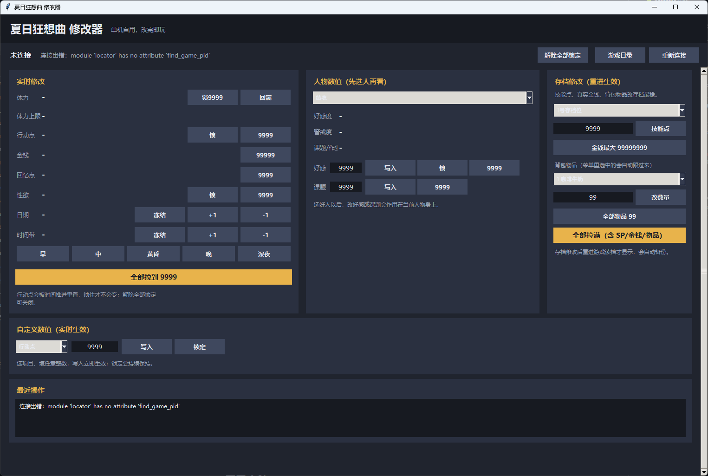

<p align="center">
  
</p>

# 夏日狂想曲修改器 (Summer Memories Trainer)

给《夏日狂想曲 / Summer Memories》用的单机修改器，双击打开窗口，点按钮就能改。



> 本项目完全由 Codex 模型 **deepseek-v4-flash** 所写。

## 功能

### 实时修改（内存修改，立即生效）

- **体力**：回满
- **体力上限**：查看 / 自定义
- **行动点**：一键 9999（被时间推进重置后可以再点一次）
- **回忆点**：一键 9999
- **性欲**：一键清零
- **时间带**：直接点 早 / 中 / 黄昏 / 晚 / 深夜，也有 -1 / +1 微调
- **全部拉到 9999**（体力、行动点、回忆点、好感、课题等）

### 人物数值

先选人物（结衣 / 莉音 / 美雪 / 姑父），就能看到当前的好感度、警戒度、课题/作业进度：

- **好感度**：自定义值写入 / 一键 9999（姑父没有好感度）
- **警戒度**：自定义值写入 / 一键清零（姑父只有警戒度可改）
- **课题/作业**：自定义值写入 / 一键 9999（姑父没有课题）

### 自定义数值

窗口中间的“自定义数值”可以选任意项目（体力、体力上限、行动点、回忆点、性欲、时间带、各人物好感/警戒/课题），填任意整数后写入，立即生效。

### 存档修改（重进游戏生效）

- 技能点 SP 自定义
- 金币自定义写入（最多 9999，填太大游戏会坏）
- 背包物品数量：打开背包选中物品会自动跟过来，填数量点“改数量”
- 全部物品 99
- 全部拉满（含 SP、金币、物品、好感、课题）

存档修改前会自动备份，改完重进游戏读档才显示。

### 自定义备份存储

- **备份当前存档**：手动备份，不会自动覆盖旧备份（带时间戳）
- **恢复所选**：从备份列表里挑一个覆盖回当前存档（有确认提示）
- 支持 1 号 / 2 号存档位分别管理

### 其他

- 程序窗口带图标，exe 也有专属桌面图标

## 使用方法

### 直接运行（Windows）

1. 先打开游戏，进入存档。
2. 双击 `SummerMemoriesTrainer.exe`，弹窗问管理员权限时点“是”。
3. 如果提示没找到游戏，点窗口里的“游戏目录”，选择游戏安装目录（里面有 `www` 文件夹的那个，例如 `D:\SteamLibrary\steamapps\common\Summer Memories`）。
4. 程序会自动识别数值，点按钮就能改。

### 从源码运行

需要 Python 3（含 tkinter）与 Node.js（用于存档修改脚本）。

```bat
start_trainer_gui.bat
```

也可以直接：

```bat
python trainer_gui.py
```

## 从源码打包

```bat
pip install pyinstaller
pyinstaller SummerMemoriesTrainer.spec
```

打包产物在 `dist\SummerMemoriesTrainer.exe`。

## 文件说明

| 文件 | 作用 |
| --- | --- |
| `trainer_gui.py` | 图形界面主程序（tkinter） |
| `locator.py` | 自动扫描游戏进程内存、定位数值 |
| `memory_trainer.py` | 内存读写底层（ctypes / ReadProcessMemory） |
| `save_utils.py` | RPG Maker MV 存档读写（lz-string 解压/压缩）与备份管理 |
| `save_editor.mjs` | Node.js 存档修改脚本 |
| `start_trainer_gui.bat` | 双击启动入口（自动请求管理员权限） |
| `tubiao.ico` | exe 桌面图标 |
| `zuoshangjiao.ico` | 程序窗口图标 |
| `tubiao.jpg` | 项目展示原图 |
| `preview.png` | 界面预览图 |

## 注意

- 本工具只用于**自己本机的单机游戏存档**，请勿用于任何线上内容。
- 修改器需要管理员权限（内存读写）。
- 存档修改前会自动备份（`.rpgsave.bak`），也可以手动备份/恢复，出问题随时可以找回。

## 关于本项目

- 本项目完全由 Codex 模型 **deepseek-v4-flash** 编写。
- 仅供学习交流使用。
